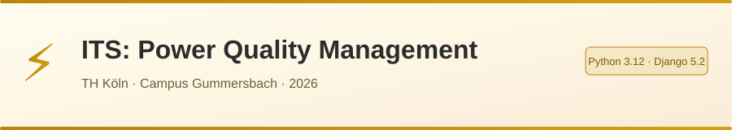

<div align="center">



# ⚡ ITS: Power Quality Management
### TH Köln – Campus Gummersbach

*One trusted view of how much power the campus uses, how clean it is, and what to do about it.*


</div>

---

## 📑 Contents

- [Why this project](#-why-this-project)
- [What the system does](#-what-the-system-does)
- [System architecture](#-system-architecture)
- [Tech stack](#-tech-stack)
- [Security](#-security)
- [Roadmap](#-roadmap)
- [Getting started](#-getting-started)
- [Repository structure](#-repository-structure)
- [How we work together](#-how-we-work-together)
- [Team](#-team)
- [Standards and references](#-standards-and-references)

---

## 🎯 Why this project

Today every energy meter on the Gummersbach campus works on its own — nobody sees the whole picture, and data that is never collected centrally is lost. Modern building loads such as LED drivers, PCs, servers, variable-speed drives, EV chargers and PV inverters cause harmonics, flicker and other disturbances that older installations were not designed for.

This project turns the separate meters into **one system** that measures, stores, checks and explains the campus power supply.

| ⚡ Faults | 〰️ Power Quality | 🔋 High Energy Use | 🎯 Power Prioritisation |
|-----------|-----------------|-------------------|------------------------|
| Find where a fault or voltage dip came from, with recorded evidence. | Check harmonics, flicker and dips against EN 50160 before equipment is damaged. | See which buildings and feeders use the most, and when — including empty buildings. | Decide which loads come first and which can wait when a peak looms. |

> [!NOTE]
> The goal is not just a dashboard. A dashboard shows what is happening; our system also **explains why**, warns before problems, and saves facility management work.

---

## ✨ What the system does

### 🧠 Smart Features

| | Feature | What it gives the campus | How we build it |
|---|---------|--------------------------|-----------------|
| 🩺 | Data health check | Trust: we know a number is wrong before anyone acts on it | Rules every few minutes: missing data, frozen values, impossible values, sub-meters vs. main meter → 🟢 🟡 🔴 per meter |
| 📄 | Weekly power-quality report | A ready-made summary instead of digging through charts | Every Monday: last week vs. EN 50160 limits, pass/fail verdict, sent by e-mail |
| 🕵️ | Event detective | Tells whether a voltage dip came from the public grid or from inside the campus | Lines up the events of all meters by time (needs synchronised clocks) |
| 🏢 | Campus context & waste finder | Shows energy used when buildings are empty | Adds timetable, holidays and weather; clustering finds unusual days |
| 🔔 | Smart alerts | Warns when something unusual happens, e.g. ventilation running all Sunday | Rules first, then an Isolation Forest model; every alert says why |
| 📈 | Peak warning | Warns a day before the campus sets a new yearly power peak | LightGBM forecast in 15-minute steps from history, weather and timetable |

### 📊 Four Dashboards

| 🖥️ Overview | 🔎 Meter Detail | ⚖️ Compare Meters | 🗓️ Compare Time Frames |
|------------|----------------|-------------------|----------------------|
| The whole campus on one screen | One dashboard per meter, with all its values | Different meters side by side | Different periods set against each other |

### 👤 User Management

| ➕ Create Users | ➖ Delete Users | 🛡️ Roles |
|----------------|----------------|---------|
| The Admin adds a personal account and gives it a role | The Admin removes the account of anyone who leaves; access ends at once | Admin, Operator (facility management) and Viewer (read only) |

### 📱 On PC and Phone

The web app works in any browser and can be installed on phones and PCs as a **Progressive Web App (PWA)**: its own icon, full-screen view and push alerts. The phone only shows the data; all the work happens on the server.

---

## 🧱 System Architecture

Data flows through six layers, from the meter on the wall to a decision on screen.

```
🔌 Energy Meters          Modbus TCP / OPC UA
        │
📡 Edge Gateway           Python
        │
📬 Message Broker         Mosquitto (MQTT)
        │
🗄️ Database               PostgreSQL + TimescaleDB
        │
🧠 Analytics              pandas · scikit-learn · LightGBM
        │
🌐 Web App                Django + Plotly
        │
💻📱 PC and Phone          Installable PWA
```

**Across all layers:** 🔐 Logins and roles · 🧱 Separate network for the meters · 🕒 Clock sync (NTP) · 🐳 Docker and Git · 💾 Regular backups

Each part does one job and can be replaced without touching the others. If the network drops, the gateway buffers readings; if the dashboard crashes, data keeps flowing into the database.

---

## 🧰 Tech Stack

| Layer | Technology | Why |
|-------|-----------|-----|
| 🔌 Meter reading | Python · pymodbus · asyncua | Covers Modbus TCP and OPC UA meters |
| 📬 Messaging | Mosquitto (MQTT) · paho-mqtt | Industry standard, supports TLS and per-device passwords |
| 🗄️ Database | PostgreSQL + TimescaleDB · psycopg | One database for measurements and users |
| 🌐 Web app | Django 5.2 LTS | Built-in user management and strong security defaults; supported until April 2028 |
| 📊 Dashboards | Plotly | Interactive charts written in Python |
| ⏱️ Scheduled jobs | APScheduler | Health check every few minutes, report every Monday |
| 🧠 Analytics & ML | pandas · scikit-learn · LightGBM | Reports, clustering, anomaly detection, forecasting |
| 🐳 Deployment | Docker Compose | Starts the whole system with one command, on any PC or server |

---

## 🔐 Security

| Protection | How |
|-----------|-----|
| Encrypted connections | HTTPS only |
| Personal accounts and roles | Django users and groups: Admin, Operator, Viewer |
| Protection against password guessing | Account lockout with `django-axes` |
| Web attacks (SQL injection, XSS, CSRF, clickjacking) | Blocked by Django's defaults |
| No passwords in code or Git | Secrets live in a local `.env` file, excluded by `.gitignore` |
| Read-only meter access | The system can only read data; it cannot switch any equipment |
| Separate network | Meters, database and broker stay inside the campus network |
| Known vulnerabilities | Regular checks with `pip-audit` |

We measure ourselves against the **OWASP Top 10** for the web application and **IEC 62443** for the industrial side.

> [!IMPORTANT]
> Never commit passwords, `.env` files or raw campus meter data to this repository.

---

## 📅 Roadmap

| Phase | When | What | Status |
|-------|------|------|--------|
| 🔍 Discover | October | Meet supervisors and facility management, list the meters, check the data, request IT access | 🟡 In progress |
| 📝 Plan | Late Oct – early Nov | Agree requirements, sketch the architecture | 🟡 In progress |
| 🔗 End to end | November | Collect, store and show data from one meter (simulator first) | ⬜ Planned |
| 📈 Grow | December | Connect all meters; handle gaps, outages and timestamps | ⬜ Planned |
| 🧠 Add the brain | January | Power-quality evaluation, weekly reports, alerts, machine learning | ⬜ Planned |
| 🎓 Finish | Late Jan – Feb | Test, document, hand over, report and presentation | ⬜ Planned |

### Progress so far

- [x] Session 1 plan: vision, ideas, requirements and blueprint
- [x] Team meeting 1 (21 Oct 2026): ideas agreed, NILM left out of scope
- [x] Poster presented to the supervisors (26 Oct 2026)
- [x] Development environment set up: Python, Docker, Git
- [x] Meter model and data specification confirmed
- [x] Network access and server agreed with campus IT
- [ ] Step 1: Django skeleton with login and roles

---

## 🚀 Getting Started

> [!NOTE]
> The application itself is not built yet. These steps prepare your PC for development. The full guide is in the **Development Setup Guide** in `docs/`.

**You need:** Windows 10 (22H2) or 11 · Miniforge (conda) · Git · VS Code · Docker Desktop with WSL 2

```bash
# 1. Get the code
git clone <repository address>
cd <repository folder>

# 2. Create the project's Python environment
conda create -n gmpq python=3.12 -y
conda activate gmpq

# 3. Install the exact same packages as the rest of the team
python -m pip install -r requirements-lock.txt

# 4. Check everything works
python -m django --version     # 5.2.x
docker run hello-world         # "Hello from Docker!"
```

---

## 📁 Repository Structure

```
.
├── docs/                    📚 plans, meeting minutes, poster, setup guide
├── README.md                📖 this page
├── requirements.txt         📦 Python packages we use
├── requirements-lock.txt    🔒 exact versions, for identical setups
└── .gitignore               🙈 files Git must never upload
```

More folders follow as we build: the web app, the meter gateway, the analytics programs and `docker-compose.yml`.

---

## 🤝 How We Work Together

1. **Before you start:** in VS Code, click **Sync** to get the latest changes.
2. Work on your part and save your files.
3. Commit with a short, clear message — e.g. `Add meeting minutes 28 Oct`.
4. **Sync again** to upload your changes.

📌 Documents go in `docs/` · 🔑 Passwords go in `.env` (never committed) · 🗃️ Raw meter data goes in `data/raw/` (never committed)

---

## 👥 Team

| | Name |
|---|------|
| 👨‍💻 | Gaurav Lokhande |
| 👩‍💻 | Krishnapriya Nair |
| 👩‍💻 | Hanna Pohl |

**Supervisors:** Prof. Dr. Michael Freiburg · Prof. Dr. Felix Hackelöer  
**Partner:** TH Köln facility management

---

## 📚 Standards and References

- **EN 50160** – Voltage characteristics of public electricity networks
- **IEC 61000-4-30** – Power quality measurement methods
- **EnEfG § 6** (Energieeffizienzgesetz) – Energy-saving duties of public bodies
- **OWASP Top 10** – Security guidance for web applications
- **IEC 62443** – Security for industrial systems

---

<div align="center">

Made with ⚡ at TH Köln, Campus Gummersbach

</div>
